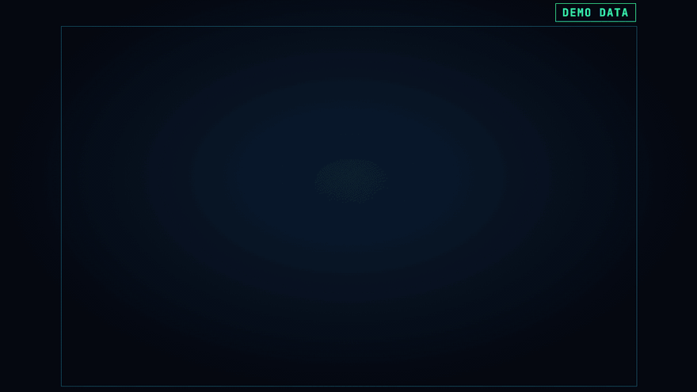
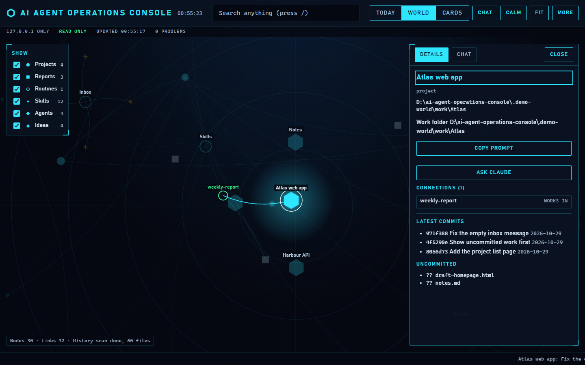
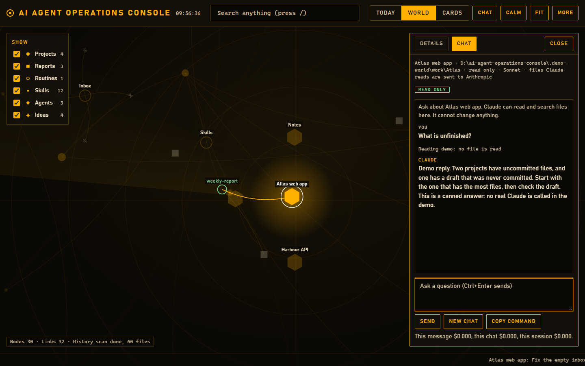

# AI agent operations console

Built for my own business. Published as an example version with demo data.

A local page that shows your work folders, reports, skills and agents as a map, opens on what needs you today,
and lets you ask Claude Code about any node, read only.

It runs on your computer only. It reads folders and git, and writes one thing: a line added to `INBOX.md` when
you add an idea.



## Try it in one command

You need Windows 11, Python 3.13 and git on your path. Nothing else: there is nothing to install.

```powershell
python demo.py
```

This builds a made-up world (four projects, a dozen skills, three agents, a routine, some history) in
`.demo-world`, starts the server and opens your browser. The chat in the demo is answered by a canned script, so
nothing is sent anywhere and nothing is spent. `start.cmd` does the same.




## Use it on your own folders

The server needs an index: a folder holding a `CLAUDE.md` with two tables, and an `INBOX.md`. The tables are read
as they are written here:

```markdown
## Where things are

| What | Where |
|---|---|
| Atlas web app | `C:\work\Atlas` |

## Where each routine leaves its report

| Routine | When | Report |
|---|---|---|
| Weekly report | Mondays | `C:\work\reports\weekly\YYYY-MM-DD.md` |
```

```powershell
python serve_dashboard.py --root C:\path\to\index-folder
```

`--home` points at the Claude folder to read skills, agents and history from. It defaults to `~\.claude`.

## Turning the chat on for real

The chat runs Claude Code, so Claude Code must be installed and signed in. It refuses to start until you have run
the gate once for the version you have installed:

```powershell
python tests\chat_gate.py
```

The gate sends about a dozen small real messages (about 5 pence, $0.06, of usage when it was last run) in a throwaway
folder with decoy secrets, checks that Claude Code cannot change anything, read outside its folder or read secret
files, and only then writes `tested_claude_version.txt`. Update Claude Code and the chat switches itself off until
you run the gate again. `python tests\chat_gate.py --small` sends one message to show the stream format and cost.

How the chat is locked down, what was tested and what was not is in [docs/WRITEUP.md](docs/WRITEUP.md).

## Tests

```powershell
pip install -r requirements-dev.txt
python -m pytest tests --ignore=tests/browser_check.py
python tests\browser_check.py shots
python tools\mutation_check.py
```

- `pytest` runs the unit and server tests. None of them calls the real Claude Code: they use `tests/fake_claude.py`.
- `browser_check.py` drives the demo world in Edge at phone and desktop width. Set `OS_DETECTOR` to a design
  detector command to run one; otherwise that step is skipped.
- `mutation_check.py` breaks each protection on purpose, on a temporary copy, and checks that a test fails. See the
  write-up for what that proves and what it does not.

## What is where

| File | What it does |
|---|---|
| `serve_dashboard.py` | The server: 127.0.0.1 only, a token on every call, one write (the inbox line). |
| `chat.py` | The Claude Code command, the folders it may see, the process limits and the safe event stream. |
| `world.py`, `build_dashboard.py` | Reads folders, git, skills, agents and history into the map and the Today page. |
| `web/` | The page. No outside addresses, no inline script, text set with `textContent` only. |
| `demo.py`, `demo_claude.py` | The made-up world and the canned chat. |
| `tests/`, `tools/` | Tests, the gate, the mutation checker and the screenshot script. |

## Limits

Written and tested on Windows 11 with Python 3.13 and one version of Claude Code. The process kill uses a Windows
job object and `taskkill`, so other systems are untested. Files that Claude reads in the chat are sent to
Anthropic. Read the limits section of the write-up before you point it at a folder that holds anything private.

## Licence

MIT. See `LICENSE`.
